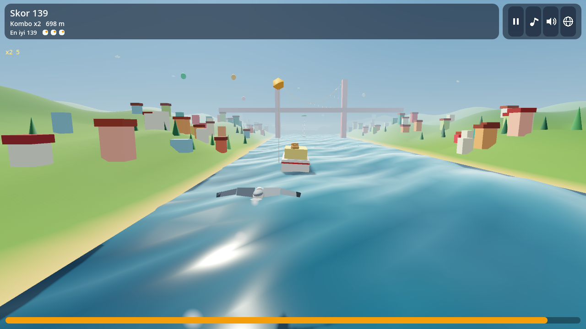
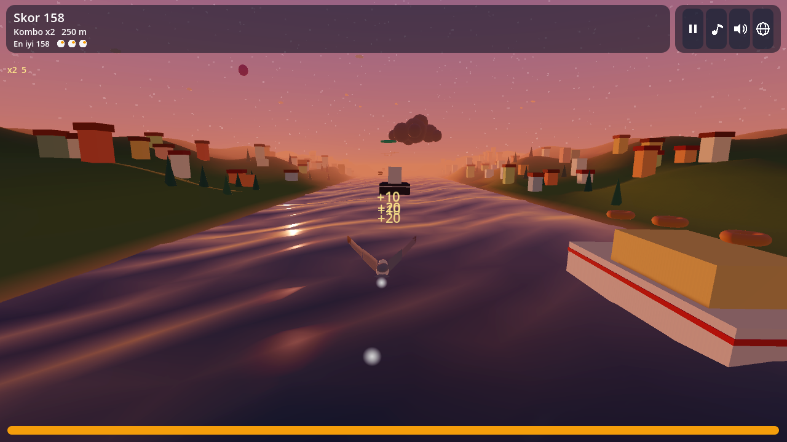
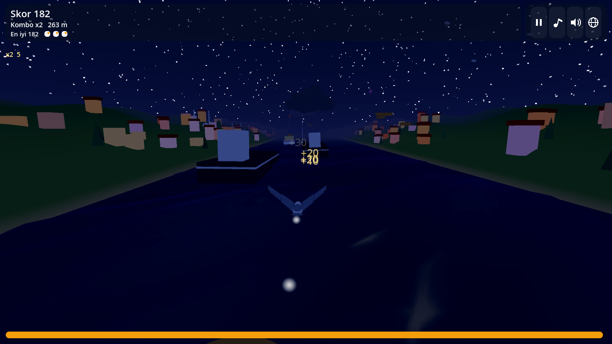
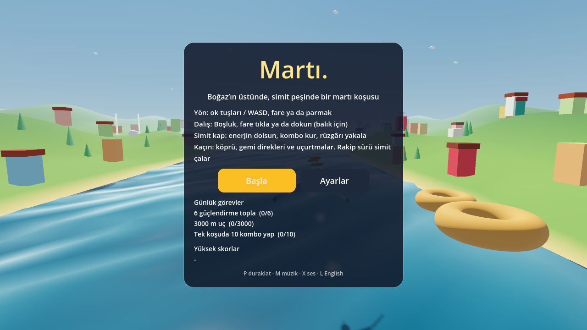
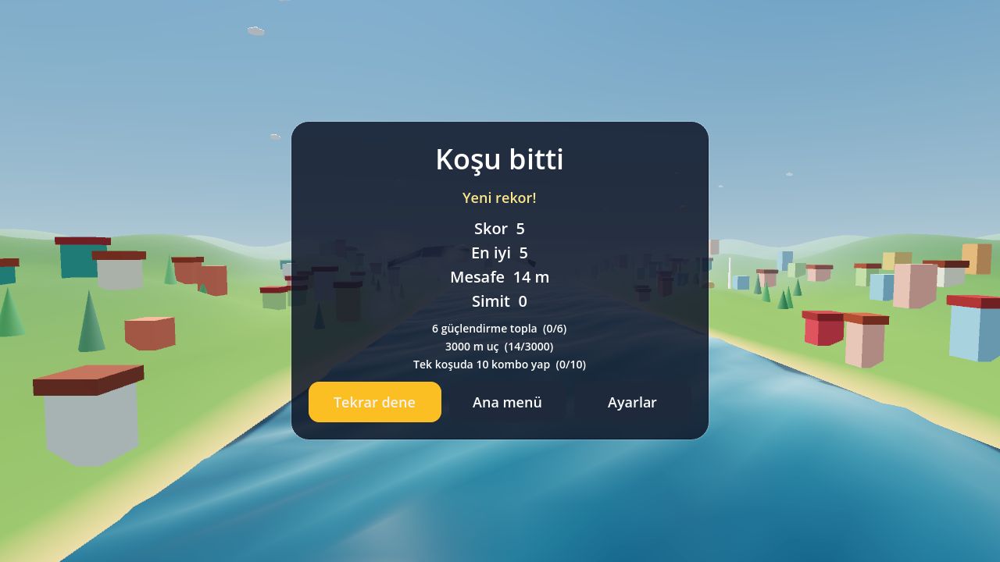
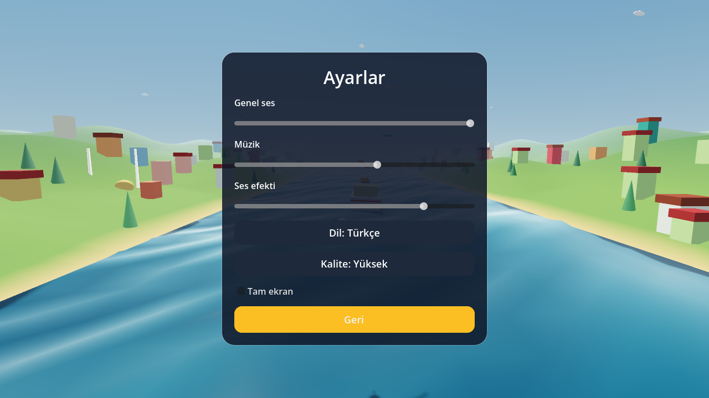
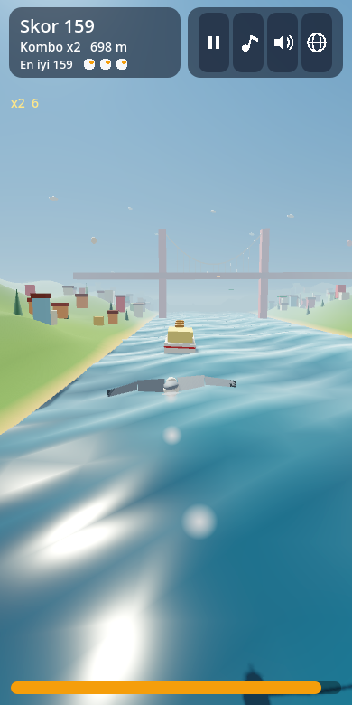

# 🕊️ Martı · Seagull Run (Godot 4)

**[▶ Play in your browser](https://furkiozknn.github.io/marti-godot/)** · Türkçe & English · desktop & mobile · free, no install

🏟️ Part of **[Claude Game Arena](https://github.com/Furkiozknn/claude-game-arena)**, round 2: every model remakes its own
round-1 browser game in Godot 4. This one was rebuilt by **Claude Haiku 5.5** from its Three.js original,
[Martı](https://github.com/Furkiozknn/marti). [See all games and the scorecard →](https://furkiozknn.github.io/claude-game-arena/)

An endless 3D arcade flyer: fly a seagull along the Istanbul strait, snatch simit from ferries, dive for fish,
dodge bridges, ship masts and kites, and fly from a golden afternoon through sunset into a night of fireworks.



| | |
|---|---|
|  |  |
|  |  |
|  |  |

## Features

- **3D world**: sea and land are vertex-shader surfaces (no per-frame CPU mesh work), one shadowed sun,
  fog, filmic tonemapping, a sky that goes from day to sunset to night, stars, moon and fireworks.
- **Gameplay** (same rules as round 1): simit pick-ups with a combo multiplier, fish dives, three power-ups
  (tailwind, golden simit, shield feather), a rival flock that steals simit, storms that push the gull,
  kites, ferries with simit on deck, bridges with cables, and speed that rises over time.
- **Daily missions**: three of five missions are chosen per day from a seeded shuffle; completing one adds points.
- **Menus**: title, pause, game over, settings, with fade transitions and a scale-in on each card.
- **Settings**: master, music and sound-effect volume, language (Turkish / English), quality (low / high),
  fullscreen, music and sound on/off.
- **Juice**: flapping wings that fold at the wrist, banking and pitching gull, feather trail, soft round
  particle bursts, screen shake on hits, "+points" pop-ups, camera follow and FOV change in portrait.
- **Data in resources**: boats (`data/boats/*.tres`), missions (`data/missions/*.tres`) and tuning values
  (`data/game_config.tres`) are Resource files, separate from the code.
- **Save system**: high scores (top 5), settings and daily missions in `user://marti_save.json`.
- **Audio**: every sound effect and the music loop are synthesised in code (no audio files). The music is
  rendered one bar per frame so the browser never stalls.
- **Autoplay bot**: `--auto` plays the game, and `GameState.get_state_text()` returns the state as JSON.

## Controls

| Action | Keyboard | Mouse / touch | Gamepad |
|---|---|---|---|
| Steer | Arrow keys / WASD | Move the pointer or finger | Left stick |
| Dive (fish) | Space (hold) | Hold the mouse button; a quick tap on touch | A |
| Start / retry | Enter or Space | Click or tap | A |
| Pause | P or Esc | Pause button | Start |
| Music on/off | M | Music button | |
| Sound effects on/off | X | SFX button | |
| Language | L | EN / TR button | |

## Run it

Requirements: Godot 4.7 (standard build, no .NET).

```powershell
godot_console --path "D:\Claude Projeleri Master\marti-godot"
```

Open the project in the editor and press F5 also works; the main scene is `res://scenes/main.tscn`.

### Command-line options

Options come after `--`, for example `godot_console --path <REPO_DIR> -- --auto --no-save`.

| Option | Meaning |
|---|---|
| `--auto` | The bot flies (title demo, game over demo, and the real run too). |
| `--auto-quit` | With `--auto`: print the finished run as `BOT RUN {...}` and quit. |
| `--no-save` | Never write `user://marti_save.json`. Use it for bot runs and tests. |
| `--lang=en` / `--lang=tr` | Start in English or Turkish for this session. |
| `--t0=<seconds>` | Start the sky at a run time: 0 is morning, 120 is sunset, 175 is night. |
| `--d0=<metres>` | Start a run this far along the strait (shows the bridge sooner). |
| `--screen=<name>` | Open `title`, `settings`, `pause`, `hud` or `over` first (for screenshots). |
| `--run` | Start a run straight away. |
| `--end-after=<seconds>` | End the run after this much run time (for the game-over screen). |
| `--trace` | Print the game state as JSON once per second. |

Example bot run (headless, about 10 s on a laptop):

```powershell
godot_console --headless --path "D:\Claude Projeleri Master\marti-godot" --fixed-fps 60 --quit-after 400000 -- --auto --auto-quit --no-save
```

## Tests and checks

```powershell
# unit tests for the core rules: prints "TESTS PASSED n/n" (exit 0) or "TESTS FAILED k/n" (exit 1)
godot_console --headless --path "D:\Claude Projeleri Master\marti-godot" --scene res://tests/run_tests.tscn

# import check after adding files: must finish without errors
godot_console --headless --path "D:\Claude Projeleri Master\marti-godot" --import

# visual check with Movie Maker (writes PNG frames; keep runs short)
godot_console --path "D:\Claude Projeleri Master\marti-godot" --write-movie <TMP>\frames\f.png --fixed-fps 30 --quit-after 150 -- --auto --run --t0=120 --no-save
```

## Web build

`export_presets.cfg` has a preset named **Web** that writes `build/web/index.html`. Threads are off
(`variant/thread_support=false`), so GitHub Pages can host it without special headers. Export from the
editor (Project > Export) or with `godot_console --headless --export-release "Web"`. Export templates must be installed.

Performance notes: on the web the default quality is **low** (1024 hard shadows, no glow, fewer particles,
no MSAA). Repeated objects are MultiMeshes, and procedural textures are built once.

## Project layout

```
scenes/main.tscn        entry scene (a Node with main.gd)
scripts/main.gd         app flow, input map, command-line options
scripts/game_world.gd   3D scene and simulation (sea, sky, gull, spawning, collisions)
scripts/game_ui.gd      HUD, title, pause, game over, settings
scripts/game_state.gd   autoload: run numbers and rules, get_state_text()
scripts/save_system.gd  autoload: settings, high scores, daily missions (user://)
scripts/sound.gd        autoload: synthesised sound effects and music
scripts/level.gd        plain data: obstacles, pick-ups, shore props
scripts/level_spawner.gd  decides what appears ahead
scripts/bot.gd          autoplay lane picker
scripts/gull.gd         the seagull model and flapping
scripts/bridge_geometry.gd, mesh_kit.gd, fx.gd, loc.gd, cli.gd   helpers
data/                   game_config.tres, boats/, missions/
tests/run_tests.gd      headless unit tests
docs/                   showcase screenshots (ignored by Godot via .gdignore)
```

## Known issues

- On a window close the game stops the audio and waits one frame before quitting, which avoids the
  `ObjectDB instances were leaked at exit` message. Movie Maker runs that end with `--quit-after` still print it
  once (the music playback); it does not affect play.
- The web build was not exported here (export templates are not installed locally); the preset is in place.

## How it was made

Round 2 of a series in which **every game is built by a different AI model**. Each model gets the same brief,
[`prompts/godot-remake.md`](https://github.com/Furkiozknn/claude-game-arena/blob/main/prompts/godot-remake.md):
remake your own round-1 game in Godot 4.7 (GDScript, Compatibility renderer) and make it better, not just equal.
This one was built by **Claude Haiku 5.5** (`claude-haiku-5-5`) with [Claude Code](https://claude.com/claude-code).
The orchestrating session re-ran the checks independently: `TESTS PASSED 43/43`, a clean headless import, and full
`--auto` bot runs (from about 70 s to 650 s depending on the run). Review found seven visual and UI issues (overexposed
look, a flat sunset, a gull that did not read as a gull, blob-like fish, a hard-to-read HUD, the portrait framing and an
audio leak warning), which the builder fixed in one review round.

The web build is exported on GitHub's servers by [`.github/workflows/pages.yml`](.github/workflows/pages.yml)
(pinned, checksum-verified Godot 4.7.2 and export templates) and published to GitHub Pages.

## License

Code: [MIT](LICENSE). Everything (models, terrain, music, sound) is generated in code; no third-party assets.
