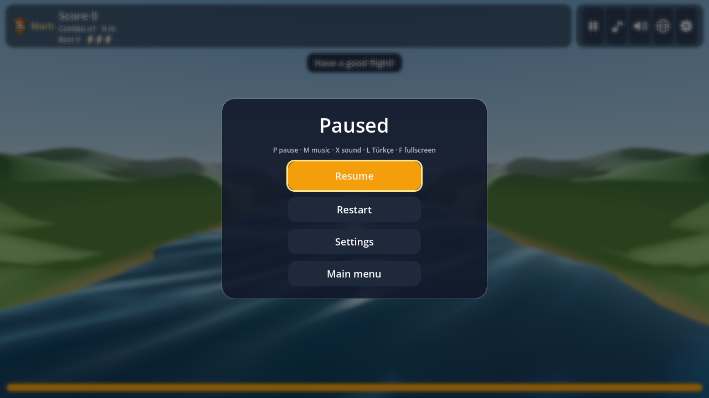

# 🕊️ Martı · Seagull Run (Godot 4)

**[▶ Play in your browser](https://furkiozknn.github.io/marti-godot/)** · Türkçe & English · desktop & mobile · free, no install

🏟️ Part of **[Claude Game Arena](https://github.com/Furkiozknn/claude-game-arena)**, round 2: every model remakes its own
round-1 browser game in Godot 4. This one was rebuilt by **Claude Haiku 5.5** from its Three.js original,
[Martı](https://github.com/Furkiozknn/marti). [See all games and the scorecard →](https://furkiozknn.github.io/claude-game-arena/)

An endless 3D arcade flyer: fly a seagull along the Istanbul strait, snatch simit from ferries, dive for fish,
dodge bridges, ship masts and kites, and fly from a golden afternoon through sunset into a night of fireworks.


| | |
|---|---|
|  |  |
|  |  |
|  |  |
|  | |

## Features

- **3D world**: sea and land are vertex-shader surfaces (no per-frame CPU mesh work; the grid is snapped, so
  waves and hills never wobble), one shadowed sun on the side of the visible sun disc, fog, filmic tonemapping,
  a sky that blends smoothly from day to sunset to night, stars, moon and fog-free fireworks. At night only the
  house windows glow.
- **Generated models**: simit, golden simit, fish, shield feather, ferry, fishing boat, sailboat, mosques,
  yalı, Galata tower and the Maiden's tower are the same GLB models as the browser version (see Assets).
- **The gull**: a procedural gull with the same design as the browser version: tapered two-layer wings (grey
  tops, white undersides, black tips with a white spot), a grey mantle and a fan tail. The rival flock uses the
  same bird with flat wings that flap in a vertex shader, and flies in a V that points where it goes.
- **Gameplay** (same rules as round 1): simit pick-ups with a combo multiplier, fish dives, three power-ups
  (tailwind, golden simit, shield feather), a rival flock that steals simit, storms that push the gull,
  kites, ferries with simit on deck, bridges with cables, and speed that rises over time. Every boat's
  cabins, masts and sails are solid (collision boxes in `data/boats/*.tres`).
- **Daily missions**: three of five missions are chosen per day from a seeded shuffle; completing one adds points.
- **Menus** (the Claude Game Arena layout): a title card with the crest, best scores and the credit line; a
  pause menu with Resume, Restart, Settings and Main menu over a dimmed, blurred backdrop; a game-over card
  with the reason (three hits or out of stamina) and Play again; settings. Every button has a visible focus
  ring, and touch screens get 44 px targets. The HUD shows the crest and the name, the stats and five icon
  buttons (pause, music, sound, language, settings); on a narrow phone the icons wrap under the stats.
- **Settings**: master, music and sound-effect volume, language (Turkish / English), quality (low / high),
  fullscreen, music and sound on/off. Defaults: master 80 %, music 60 %, effects 80 %, the OS language.
- **Juice**: flapping wings that fold at the wrist, banking and pitching gull, feather trail, soft round
  particle bursts (one pooled MultiMesh, one draw call), screen shake on hits, "+points" pop-ups, a ferry
  horn, a game-over jingle that ducks the music, camera follow and FOV change in portrait.
- **Data in resources**: boats (`data/boats/*.tres`), missions (`data/missions/*.tres`) and tuning values
  (`data/game_config.tres`) are Resource files, separate from the code.
- **Save system**: high scores (top 5), settings and daily missions in `user://marti_save.json`.
- **Audio**: every sound effect and the music loop are synthesised in code (no audio files). The music is
  rendered one bar per frame so the browser never stalls, and it loops without a gap. Pause and a lost window
  focus freeze all sound.
- **Autoplay bot**: `--auto` plays the game, and `GameState.get_state_text()` returns the state as JSON.

## Controls

| Action | Keyboard | Mouse / touch | Gamepad |
|---|---|---|---|
| Steer | Arrow keys / WASD | Move the mouse; on touch, drag (relative to where the finger went down) | Left stick |
| Dive (fish) | Space (hold) | Hold the mouse button; a quick tap on touch | A |
| Start / play again | Enter or Space | Start / Play again button | A |
| Pause / back | P or Esc | Pause button | Start |
| Music on/off | M | Music button | |
| Sound effects on/off | X | Sound button | |
| Language | L | Globe button | |
| Fullscreen | F | Settings | |
| Settings | | Gear button (pauses the run) | |

Losing the window focus (another app, a hidden browser tab) pauses the run.

## Run it

Requirements: Godot 4.7 (standard build, no .NET).

```powershell
godot_console --path "D:\Claude Projeleri Master\marti-godot"
```

Open the project in the editor and press F5 also works; the main scene is `res://scenes/main.tscn`.

### Command-line options

Options come after `--`, for example `godot_console --path <REPO_DIR> -- --auto --no-save`.

| Option | Meaning |
|---|---|
| `--auto` | The bot flies (title demo, game over demo, and the real run too). |
| `--auto-quit` | With `--auto`: print the finished run as `BOT RUN {...}` and quit. |
| `--no-save` | Never write `user://marti_save.json`. Use it for bot runs and tests. |
| `--lang=en` / `--lang=tr` | Start in English or Turkish for this session. |
| `--t0=<seconds>` | Start the sky at a run time: 0 is morning, 120 is sunset, 175 is night. |
| `--d0=<metres>` | Start a run this far along the strait (shows the bridge sooner). |
| `--screen=<name>` | Open `title`, `settings`, `pause`, `hud` or `over` first (for screenshots). |
| `--run` | Start a run straight away. |
| `--end-after=<seconds>` | End the run after this much run time (for the game-over screen). |
| `--trace` | Print the game state as JSON once per second. |
| `--no-assets` | Keep the procedural models instead of the generated GLB models. |
| `--hold=<action>` | Hold an input action for the whole session, e.g. `--hold=steer_right` (steering check in Movie Maker). |

Example bot run (headless, about a minute on a laptop):

```powershell
godot_console --headless --path "D:\Claude Projeleri Master\marti-godot" --fixed-fps 60 --quit-after 400000 -- --auto --auto-quit --no-save
```

## Tests and checks

```powershell
# unit tests for the core rules: prints "TESTS PASSED n/n" (exit 0) or "TESTS FAILED k/n" (exit 1)
godot_console --headless --path "D:\Claude Projeleri Master\marti-godot" --scene res://tests/run_tests.tscn

# import check after adding files: must finish without errors
godot_console --headless --path "D:\Claude Projeleri Master\marti-godot" --import

# visual check with Movie Maker (writes PNG frames; keep runs short)
godot_console --path "D:\Claude Projeleri Master\marti-godot" --write-movie <TMP>\frames\f.png --fixed-fps 30 --quit-after 150 -- --auto --run --t0=120 --no-save
```

The tests also cover the steering direction (the camera's right axis against the steering delta, and the
projected target), the collision boxes, the hidden passed pickups, the ignored hits while blinking, the
models, the music loop length and the title clock.

## Web build

`export_presets.cfg` has a preset named **Web** that writes `build/web/index.html`. Threads are off
(`variant/thread_support=false`), so GitHub Pages can host it without special headers, and the crest is the
page icon (`html/export_icon=true`). Export from the editor (Project > Export) or with
`godot_console --headless --export-release "Web"`. Export templates must be installed.

Performance notes: on the web the default quality is **low** (1024 hard shadows, no glow, fewer particles,
no MSAA). Repeated objects are MultiMeshes, and procedural textures are built once.

## Assets

Models generated with Higgsfield Tripo, shared with the browser version
([Martı](https://github.com/Furkiozknn/marti): `assets/models`, prompts and processing in its `docs/assets.md`).
The files are normalised (+Y up, +Z forward, metres, base or centre pivot) and used 1:1. Only their textures
were re-encoded from WebP to PNG (glTF-Transform), because Godot's glTF importer reads PNG and JPEG textures.

| Model | Used as | Transform in the game |
|---|---|---|
| `simit.glb` | simit (MultiMesh) | ring in the xy plane, spins about y |
| `simit.glb` | golden simit power-up | x1.3, tint `#FFC94D`, glow `#7A4A00` |
| `fish.glb` | leaping fish (MultiMesh) | pitches along the leap: x rotation `-0.9 cos(u π/2)` |
| `feather.glb` | shield power-up | spins about y |
| `ferry.glb`, `fishing.glb`, `sail.glb` | boats | y = wave height × 0.8 - 0.2, gentle roll |
| `mosque.glb` | mosques (MultiMesh, no tint) | faces the water (y rotation +90° on the left shore, -90° on the right), sunk 0.3 into the slope |
| `yali.glb` | waterfront mansion | x = ±40..46, faces the water, sunk 0.3 |
| `galata.glb` | Galata tower | x = ±60..74, faces the water, sunk 0.3 |
| `maiden.glb` | Maiden's tower on its islet | x = ±31 in the water, y = -0.3, no collision |

The materials use the model texture with `vertex_color_use_as_albedo`, so MultiMesh instance colours still tint
them. The crest (`assets/ui/logo.png`, GPT Image) is on the title card, in the HUD (28 px), and it is the project
and web icon. With `--no-assets` (or when a file is missing) the game keeps its procedural models. The gull, the
rival flock, the tanker, the bridge, houses, trees, clouds and storms stay procedural.

## Project layout

```
scenes/main.tscn        entry scene (a Node with main.gd)
scripts/main.gd         app flow, input map, command-line options
scripts/game_world.gd   3D scene and simulation (sea, sky, gull, spawning, collisions)
scripts/game_ui.gd      HUD, title, pause, game over, settings
scripts/game_state.gd   autoload: run numbers and rules, get_state_text()
scripts/save_system.gd  autoload: settings, high scores, daily missions (user://)
scripts/sound.gd        autoload: synthesised sound effects and music
scripts/level.gd        plain data: obstacles, pick-ups, shore props
scripts/level_spawner.gd  decides what appears ahead
scripts/bot.gd          autoplay lane picker
scripts/gull.gd         the seagull model and flapping (also the rival flock mesh)
scripts/models.gd       loads the generated GLB models (one merged mesh + textured material each)
scripts/landmarks.gd    procedural fallbacks for the landmark models
scripts/sparks.gd       pooled particle bursts and fireworks (one MultiMesh each)
scripts/bridge_geometry.gd, mesh_kit.gd, fx.gd, loc.gd, cli.gd   helpers
assets/models/          generated GLB models (shared with the browser version)
assets/ui/              crest logo (title, HUD, project icon) and favicon
data/                   game_config.tres, boats/ (speed, model, collision boxes), missions/
tests/run_tests.gd      headless unit tests
docs/                   showcase screenshots (ignored by Godot via .gdignore)
```

## Known issues

- On a window close the game stops the audio and waits one frame before quitting, which avoids the
  `ObjectDB instances were leaked at exit` message. Movie Maker and headless bot runs that end with
  `--quit-after` / `--auto-quit` still print it once; it does not affect play.
- The web build was not exported here (export templates are not installed locally); the preset is in place.
- The title card has no "Loading n/N" state: the models are loaded synchronously while the world is built.

## How it was made

Round 2 of a series in which **every game is built by a different AI model**. Each model gets the same brief,
[`prompts/godot-remake.md`](https://github.com/Furkiozknn/claude-game-arena/blob/main/prompts/godot-remake.md):
remake your own round-1 game in Godot 4.7 (GDScript, Compatibility renderer) and make it better, not just equal.
This one was built by **Claude Haiku 5.5** (`claude-haiku-5-5`) with [Claude Code](https://claude.com/claude-code).
The orchestrating session re-ran the checks independently: `TESTS PASSED 43/43`, a clean headless import, and full
`--auto` bot runs (from about 70 s to 650 s depending on the run). Review found seven visual and UI issues (overexposed
look, a flat sunset, a gull that did not read as a gull, blob-like fish, a hard-to-read HUD, the portrait framing and an
audio leak warning), which the builder fixed in one review round.

An overnight pass (2026-10-21) then ported the browser version's improvements (generated models, crest, the new
gull, the steering fix, the arena menu layout) and fixed the review's Godot bugs; see [CHANGELOG.md](CHANGELOG.md).

The web build is exported on GitHub's servers by [`.github/workflows/pages.yml`](.github/workflows/pages.yml)
(pinned, checksum-verified Godot 4.7.2 and export templates) and published to GitHub Pages.

## License

Code: [MIT](LICENSE). Models and the crest were generated with Higgsfield (see Assets). Terrain, music and sound are
generated in code.
